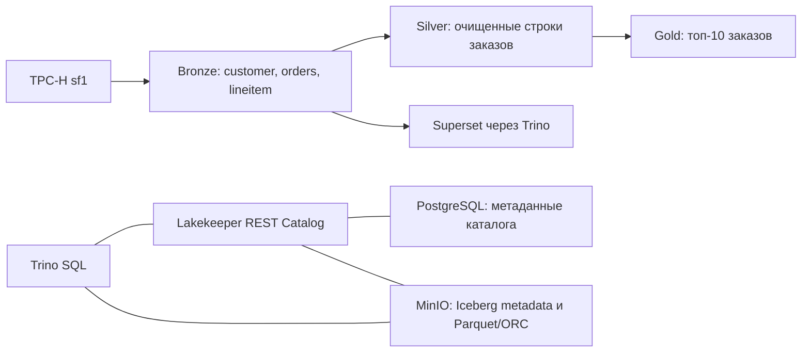

# Практическая работа №1: локальный Lakehouse и TPC-H Q3

**Студент:** Владислав Елдашов  
**Группа:** БИВТ-24-АЭ-3  
**Вариант:** 1 - Shipping Priority (Q3), назначен в таблице преподавателя.  
**Масштаб:** `tpch.sf1`.

Задача: определить десять заказов клиентов сегмента BUILDING с наибольшей выручкой, если заказ оформлен до 15 марта 1995 года, а позиции отгружены после этой даты. TPC-H - синтетический набор для торговой компании; он генерируется коннектором Trino, персональные данные реальных клиентов не используются.

**Результаты:** все проверки качества, сравнения Q3, schema evolution, time travel/rollback и подключение Superset пройдены. Отчет: [отчет.md](отчет.md). Bronze: 150 000 / 1 500 000 / 6 001 215 строк; Silver: 30 519; Gold: 10.

| Формат / кодек | Размер, МиБ | Запись, с | Q3, с |
|---|---:|---:|---:|
| Parquet / NONE | 120,10 | 29,60 | 4,30 |
| Parquet / SNAPPY | 67,83 | 25,65 | 3,35 |
| Parquet / GZIP | 46,66 | 38,41 | 4,16 |
| Parquet / ZSTD | 46,52 | 22,30 | 3,01 |
| ORC / ZSTD | 51,89 | 27,43 | 3,81 |

В таблице медианы трех записей и пяти запросов. ZSTD показал наименьшие медианы в этом запуске; диапазоны времен запросов пересекаются, поэтому преимущество по скорости нельзя считать доказанным для любого оборудования. Диапазоны, сырые замеры и условия - в отчете и `results/`.



## Запуск

Нужны Docker Desktop / Docker Engine с Compose и Python 3.10+. Практический ориентир: 7 ГБ памяти Docker и несколько ГБ свободного диска. Версии образов фиксированы в [compose.yaml](compose.yaml). Запускать из корня проекта:

```bash
bash scripts/start.sh
```

Сценарий поднимает MinIO, PostgreSQL, Lakekeeper и Trino, создает warehouse, выполняет ELT и бенчмарк, затем поднимает Superset, подключает Bronze и формирует [отчет.md](отчет.md). Первый запуск требует загрузки образов. Порты привязаны к `127.0.0.1`; пароли в конфигурации предназначены для локальной учебной среды.

| Интерфейс | Адрес | Доступ |
|---|---|---|
| Trino | http://localhost:18080 | пользователь student |
| MinIO Console | http://localhost:19001 | lakehouse / local-minio-password |
| Lakekeeper API | http://localhost:18181 | локальный режим без аутентификации |
| Superset | http://localhost:18088 | admin / local-admin-password |

Опубликованные результаты находятся в `results/`. Новый запуск пишет в `results/local/`, который исключен из Git, поэтому сохраненные измерения не блокируют первый запуск после клонирования.

Не запускайте `run.py` повторно в том же warehouse: он намеренно отказывается перезаписывать сохраненный запуск. Обычная остановка: `docker compose stop`; продолжение работы с уже созданными данными: `docker compose start`. `docker compose down` сохраняет named volumes. Для нового эксперимента используйте отдельную копию проекта, новое Compose project name и пустой каталог `results/local`, либо осознанно удалите учебные volumes.

## ELT и проверка

Bronze хранит исходные значения нужных колонок без изменения типов. Контроль качества проверяет уникальность ключей, обязательные значения, диапазоны цен/скидок и внешние ключи. Проверки не выявили дефектных строк в TPC-H. Нулевые счетчики нарушений сохраняются в `results/quality.json`.

На Silver выполняются соединения, фильтрация по сегменту и датам, нормализация строки сегмента, преобразование денежных сумм и скидок в DECIMAL, расчет чистой выручки и числа дней до отгрузки. На Gold - группировка и топ-10. При равенстве выручки добавлена сортировка по дате и ключу для воспроизводимого вывода. При чтении Gold порядок задается через `ORDER BY`: Iceberg не гарантирует порядок строк.

Скрипт сравнивает Gold с Q3 непосредственно на `tpch.sf1`: для нормализованного DECIMAL-запроса проверяется точное равенство строк, для исходного запроса преподавателя с DOUBLE - совпадение ключей/дат и отклонение выручки менее 0,01. Отдельно проверяется равенство результата каждого варианта хранения. Это учебный эксперимент по Q3, а не сертифицированный полный TPC-H benchmark.

## Методология бенчмарка

Сравниваются PARQUET/NONE, PARQUET/SNAPPY, PARQUET/GZIP, PARQUET/ZSTD и ORC/ZSTD. Данные, колонки, SQL, масштаб, отсутствие партиционирования и вычислительные ресурсы одинаковы. Конфигурации обрабатываются последовательно, в перемешанном порядке с `seed=42`. Дополнительный BI-сервис запускается после измерений.

Время записи - сумма длительностей трех CTAS из одного базового Bronze (чтение источника, запись объектов и commit Iceberg включены; DROP и проверочные запросы исключены). Выполняются три независимые записи каждой конфигурации, фиксируются медиана и диапазон. Измеряется полный цикл CTAS, поэтому это не изолированная скорость компрессора. Размер - сумма `file_size_in_bytes` из `$files` трех текущих таблиц, байты переводятся в МиБ (`/1048576`); служебные metadata, старые снапшоты и файлы удаленных таблиц в размер не входят.

Время агрегации - полный Q3 с соединением трех сохраненных Bronze-таблиц и чтением всех десяти строк ответа через HTTP API. Перед измерениями делается один прогрев каждого варианта, затем пять измерений в перемешанном порядке. Медиана, минимум и максимум сохраняются; кэши ОС не сбрасываются, поэтому это тест теплого чтения, а не холодного диска. Клиентское время измеряется `perf_counter`, server stats и query ID сохраняются отдельно. Прогрев, JIT, фоновая активность и число файлов могут влиять на результат; нельзя переносить локальные цифры напрямую на кластер.

## Снапшоты и изменение схемы

`run.py` создает отдельную таблицу `iceberg.silver.snapshot_demo` из основного факта Silver. Добавляет и переименовывает nullable-колонку, проверяет NULL для старых строк, удаляет позиции одного заказа, читает прежний снапшот через `FOR VERSION AS OF`, затем выполняет `rollback_to_snapshot`. Количество восстановленных строк проверяется. Изменение схемы и восстановление выполнены на Silver. Основной факт `silver.order_lines` и витрина Gold сохраняют свои данные. Откат снапшота восстанавливает данные, а изменение схемы отслеживается отдельно.

## Дополнительный инструмент

Superset использует Trino SQLAlchemy driver. `scripts/superset_bronze.py` регистрирует базу `Lakehouse Trino` и три Bronze datasets, затем выполняет через объект базы Superset запрос количества строк. Результат сохраняется в `results/superset.log`. В UI: Data → Datasets показывает Bronze, SQL → SQL Lab → Lakehouse Trino позволяет выполнить `SELECT * FROM iceberg.bronze.lineitem LIMIT 10`. BI работает через Trino, поэтому не управляет Iceberg-файлами самостоятельно.

## Файлы и источники

- `compose.yaml`, `config/` - инфраструктура и настройки.
- `sql/` - Silver, Gold и параметризованный Q3.
- `scripts/` - HTTP клиент, provisioning, ELT, бенчмарк и отчет.
- `results/` - фактические результаты, статистика запросов, выполненный SQL и подтверждение работы сервисов.
- [Материалы преподавателя](https://drive.google.com/drive/folders/18BELacRX90U7Z4fxeCJqI2Achj_sr8P1): распределение, варианты, форма отчета.
- [Trino 479: Iceberg](https://trino.io/docs/479/connector/iceberg.html), [TPC-H connector](https://trino.io/docs/479/connector/tpch.html).
- [Lakekeeper v0.9.5: пример стека](https://github.com/lakekeeper/lakekeeper/tree/v0.9.5/examples/minimal).
- [Superset: подключение Trino](https://superset.apache.org/docs/configuration/databases/#trino).

Репозиторий: [avolxn/lakehouse-p1](https://github.com/avolxn/lakehouse-p1). Данные таблиц хранятся в Docker volumes.
